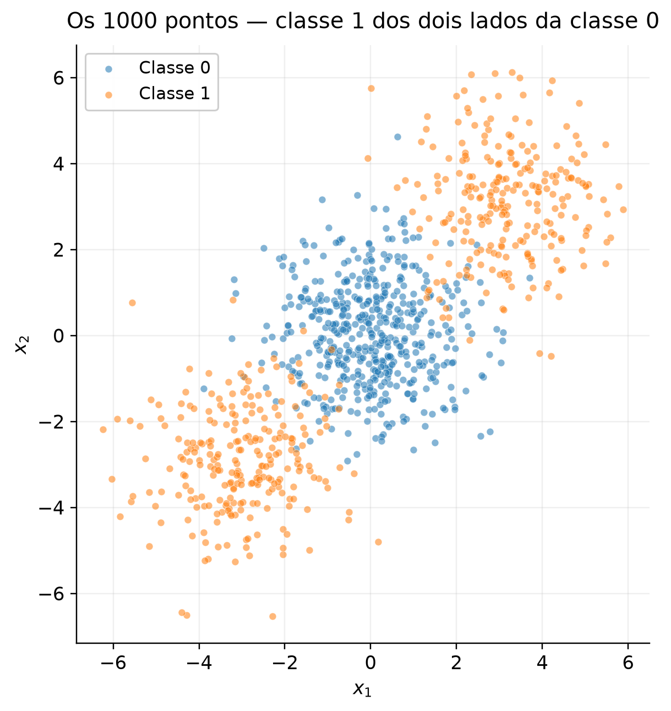
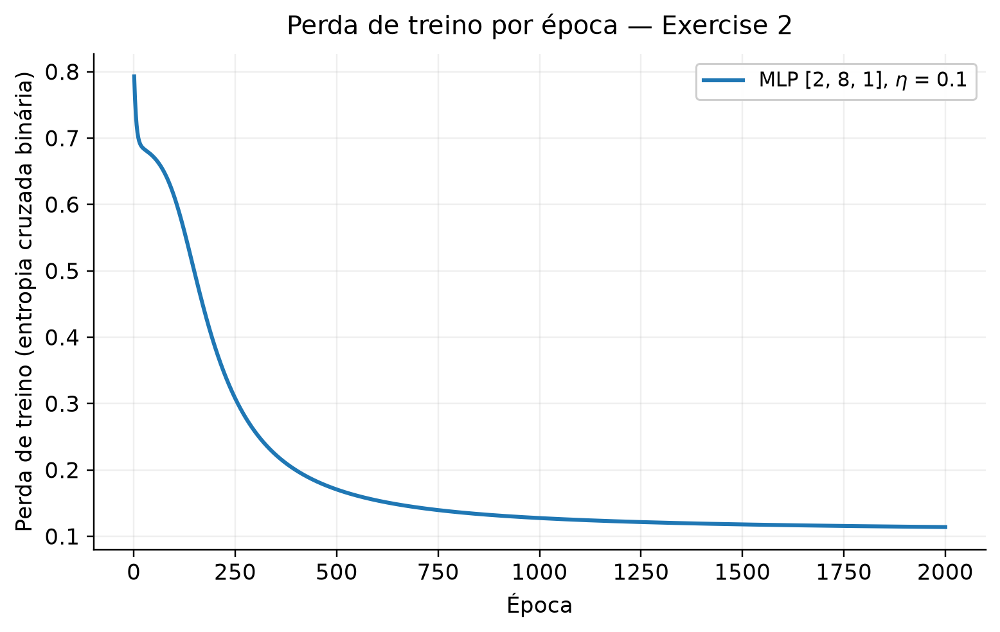
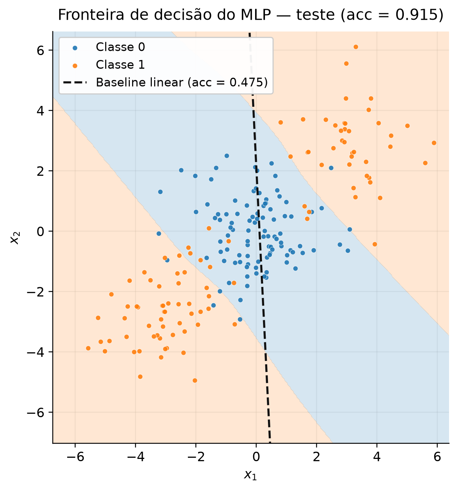
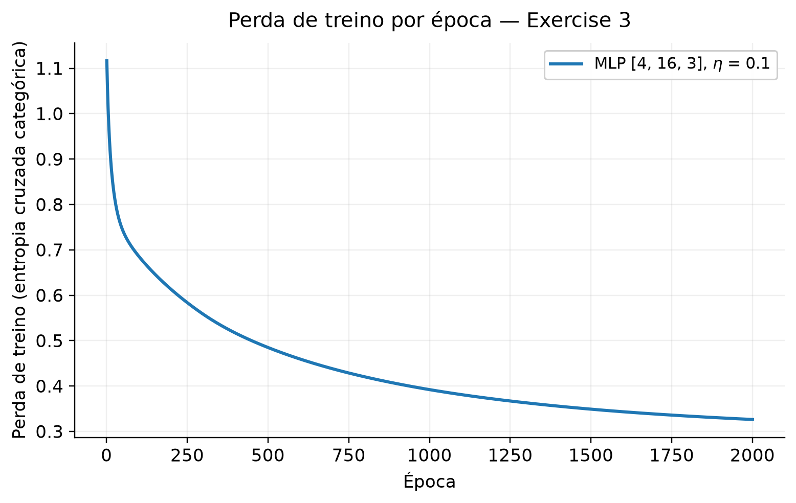
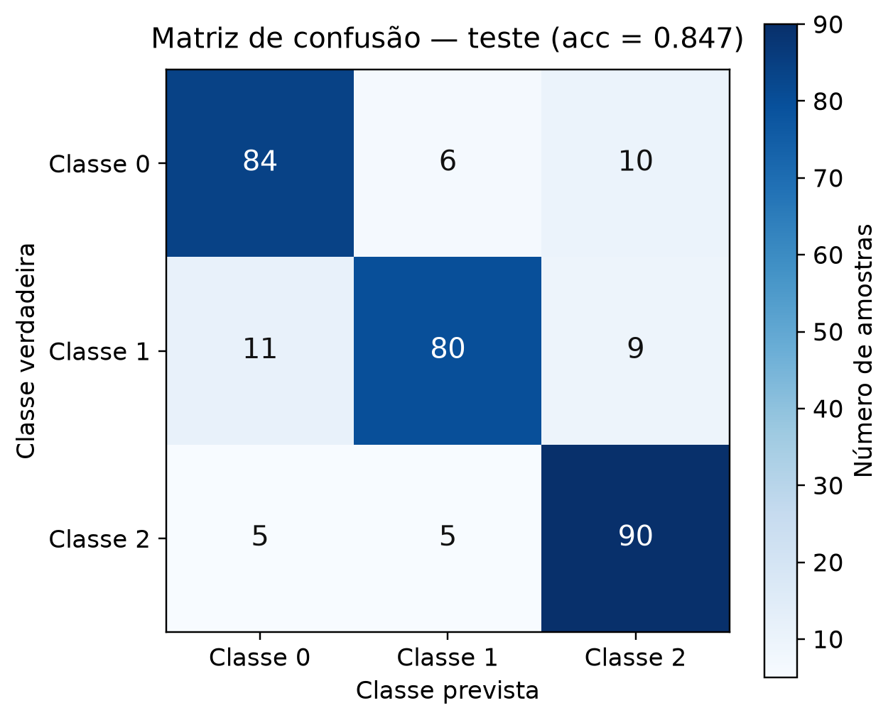
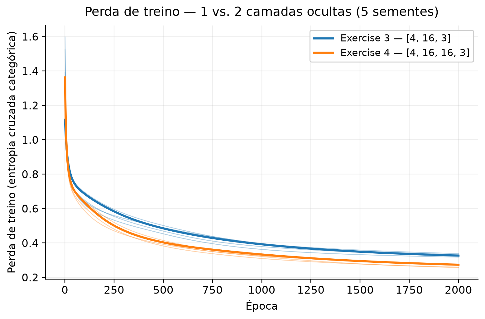

# 3. MLP

!!! abstract "Enunciado"

    [Exercises → MLP](https://insper.github.io/ann-dl/){:target='_blank'}

Nesta atividade, a ideia é ver o que uma camada oculta acrescenta a um modelo linear. O Exercício 1 faz um passo de backpropagation à mão. O Exercício 2 usa um MLP escrito do zero em um conjunto que nenhuma reta separa. O Exercício 3 leva a mesma rede para três classes, e o Exercício 4 verifica se uma segunda camada oculta ajuda.

A implementação do modelo está em [`code/mlp.py`](https://github.com/carolinaeskenazi/ann-dl/blob/main/docs/exercises/mlp/code/mlp.py) e é a mesma nos Exercícios 2, 3 e 4. O arquivo [`code/datasets.py`](https://github.com/carolinaeskenazi/ann-dl/blob/main/docs/exercises/mlp/code/datasets.py) gera e divide os dados, e [`code/plots.py`](https://github.com/carolinaeskenazi/ann-dl/blob/main/docs/exercises/mlp/code/plots.py) reúne os helpers das figuras. Os pesos são sempre inicializados a partir de `rng = np.random.default_rng(42)`, e os geradores e a divisão dos dados usam `random_state=42`.

---

## Exercise 1 — One Step of Backpropagation, by Hand

A rede tem 2 entradas, 1 camada oculta de 2 neurônios e 1 saída, com \(\tanh\) nas duas camadas e perda \(L = (y-\hat{y})^2\). Os valores dados são

$$
\mathbf{x} = \begin{bmatrix} 0.5 \\ -0.2 \end{bmatrix},\quad
y = 1.0,\quad
\mathbf{W}^{(1)} = \begin{bmatrix} 0.3 & -0.1 \\ 0.2 & 0.4 \end{bmatrix},\quad
\mathbf{b}^{(1)} = \begin{bmatrix} 0.1 \\ -0.2 \end{bmatrix},
$$

$$
\mathbf{W}^{(2)} = \begin{bmatrix} 0.5 & -0.3 \end{bmatrix},\quad
b^{(2)} = 0.2,\quad
\eta = 0.3.
$$

Todas as contas abaixo foram feitas à mão e estão com 6 casas decimais.

### A — Forward pass

**Pré-ativações ocultas**, \(\mathbf{z}^{(1)} = \mathbf{W}^{(1)}\mathbf{x} + \mathbf{b}^{(1)}\):

$$
z^{(1)}_1 = 0.3(0.5) + (-0.1)(-0.2) + 0.1 = 0.15 + 0.02 + 0.1 = 0.270000
$$

$$
z^{(1)}_2 = 0.2(0.5) + 0.4(-0.2) - 0.2 = 0.10 - 0.08 - 0.2 = -0.180000
$$

**Ativações ocultas**, \(\mathbf{h}^{(1)} = \tanh(\mathbf{z}^{(1)})\):

$$
h^{(1)}_1 = \tanh(0.27) = 0.263625
$$

$$
h^{(1)}_2 = \tanh(-0.18) = -0.178081
$$

**Pré-ativação da saída**, \(u^{(2)} = \mathbf{W}^{(2)}\mathbf{h}^{(1)} + b^{(2)}\):

$$
u^{(2)} = 0.5(0.263625) + (-0.3)(-0.178081) + 0.2 = 0.131812 + 0.053424 + 0.2 = 0.385237
$$

**Saída e perda:**

$$
\hat{y} = \tanh(0.385237) = 0.367247
$$

$$
L = (1.0 - 0.367247)^2 = (0.632753)^2 = 0.400377
$$

### B — Backward pass

**Perda em relação à saída.** Como \(L = (y-\hat{y})^2\),

$$
\frac{\partial L}{\partial \hat{y}} = -2\,(y - \hat{y}) = -2(0.632753) = -1.265507
$$

**Pré-ativação da saída.** Como \(\hat{y} = \tanh(u^{(2)})\) e \(\frac{d}{du}\tanh(u) = 1 - \tanh^2(u)\),

$$
\frac{\partial L}{\partial u^{(2)}}
= \frac{\partial L}{\partial \hat{y}}\,(1 - \hat{y}^2)
= -1.265507 \times (1 - 0.367247^2)
= -1.265507 \times 0.865130
= -1.094828
$$

**Camada de saída.** Como \(u^{(2)} = \mathbf{W}^{(2)}\mathbf{h}^{(1)} + b^{(2)}\), a derivada de \(u^{(2)}\) em relação a cada peso é a ativação que ele multiplica, e em relação ao bias é 1:

$$
\frac{\partial L}{\partial \mathbf{W}^{(2)}}
= \frac{\partial L}{\partial u^{(2)}}\,\mathbf{h}^{(1)\top}
= -1.094828 \begin{bmatrix} 0.263625 & -0.178081 \end{bmatrix}
= \begin{bmatrix} -0.288624 & 0.194968 \end{bmatrix}
$$

$$
\frac{\partial L}{\partial b^{(2)}} = \frac{\partial L}{\partial u^{(2)}} = -1.094828
$$

**De volta à camada oculta.** Cada \(h^{(1)}_j\) chega à saída multiplicado por \(W^{(2)}_j\):

$$
\frac{\partial L}{\partial \mathbf{h}^{(1)}}
= \mathbf{W}^{(2)\top}\,\frac{\partial L}{\partial u^{(2)}}
= -1.094828 \begin{bmatrix} 0.5 \\ -0.3 \end{bmatrix}
= \begin{bmatrix} -0.547414 \\ 0.328448 \end{bmatrix}
$$

Passando pela \(\tanh\) da camada oculta, com \(1 - (h^{(1)})^2 = [0.930502,\ 0.968287]\):

$$
\frac{\partial L}{\partial \mathbf{z}^{(1)}}
= \frac{\partial L}{\partial \mathbf{h}^{(1)}} \odot \left(1 - (\mathbf{h}^{(1)})^2\right)
= \begin{bmatrix} -0.547414 \times 0.930502 \\ 0.328448 \times 0.968287 \end{bmatrix}
= \begin{bmatrix} -0.509370 \\ 0.318032 \end{bmatrix}
$$

**Camada oculta.** Como \(\mathbf{z}^{(1)} = \mathbf{W}^{(1)}\mathbf{x} + \mathbf{b}^{(1)}\), o gradiente de \(W^{(1)}_{ji}\) é \(\partial L/\partial z^{(1)}_j\) vezes \(x_i\):

$$
\frac{\partial L}{\partial \mathbf{W}^{(1)}}
= \frac{\partial L}{\partial \mathbf{z}^{(1)}}\,\mathbf{x}^\top
= \begin{bmatrix} -0.509370 \\ 0.318032 \end{bmatrix}
\begin{bmatrix} 0.5 & -0.2 \end{bmatrix}
= \begin{bmatrix} -0.254685 & 0.101874 \\ 0.159016 & -0.063606 \end{bmatrix}
$$

$$
\frac{\partial L}{\partial \mathbf{b}^{(1)}} = \frac{\partial L}{\partial \mathbf{z}^{(1)}}
= \begin{bmatrix} -0.509370 \\ 0.318032 \end{bmatrix}
$$

### C — Parameter update

Cada parâmetro recebe \(\theta \leftarrow \theta - 0.3\,\partial L/\partial\theta\). O enunciado fala em oito parâmetros, mas a rede tem **nove**: 4 pesos em \(\mathbf{W}^{(1)}\), 2 biases em \(\mathbf{b}^{(1)}\), 2 pesos em \(\mathbf{W}^{(2)}\) e 1 bias \(b^{(2)}\). A tabela traz os nove:

| Parâmetro        | Valor antigo | Gradiente     | Valor novo                               |
| ---------------- | -----------: | ------------: | ---------------------------------------- |
| \(W^{(2)}_{1}\)  | \(0.5\)      | \(-0.288624\) | \(0.5 + 0.086587 = \mathbf{0.586587}\)   |
| \(W^{(2)}_{2}\)  | \(-0.3\)     | \(0.194968\)  | \(-0.3 - 0.058490 = \mathbf{-0.358490}\) |
| \(b^{(2)}\)      | \(0.2\)      | \(-1.094828\) | \(0.2 + 0.328448 = \mathbf{0.528448}\)   |
| \(W^{(1)}_{11}\) | \(0.3\)      | \(-0.254685\) | \(0.3 + 0.076405 = \mathbf{0.376405}\)   |
| \(W^{(1)}_{12}\) | \(-0.1\)     | \(0.101874\)  | \(-0.1 - 0.030562 = \mathbf{-0.130562}\) |
| \(W^{(1)}_{21}\) | \(0.2\)      | \(0.159016\)  | \(0.2 - 0.047705 = \mathbf{0.152295}\)   |
| \(W^{(1)}_{22}\) | \(0.4\)      | \(-0.063606\) | \(0.4 + 0.019082 = \mathbf{0.419082}\)   |
| \(b^{(1)}_{1}\)  | \(0.1\)      | \(-0.509370\) | \(0.1 + 0.152811 = \mathbf{0.252811}\)   |
| \(b^{(1)}_{2}\)  | \(-0.2\)     | \(0.318032\)  | \(-0.2 - 0.095410 = \mathbf{-0.295410}\) |

Ou seja,

$$
\mathbf{W}^{(1)} = \begin{bmatrix} 0.376405 & -0.130562 \\ 0.152295 & 0.419082 \end{bmatrix},\quad
\mathbf{b}^{(1)} = \begin{bmatrix} 0.252811 \\ -0.295410 \end{bmatrix},\quad
\mathbf{W}^{(2)} = \begin{bmatrix} 0.586587 & -0.358490 \end{bmatrix},\quad
b^{(2)} = 0.528448.
$$

**A perda desce.** O gradiente aponta para onde \(L\) cresce mais rápido, e a atualização anda no sentido contrário. Dá para ver isso nos sinais: a saída está abaixo do alvo (\(\hat{y} = 0.3672 < 1\)), então \(\partial L/\partial u^{(2)}\) é negativo e todo parâmetro é movido no sentido que aumenta \(u^{(2)}\) — por exemplo, \(b^{(2)}\) sobe de \(0.2\) para \(0.5284\).

Refazendo o forward com os parâmetros novos:

$$
\mathbf{z}^{(1)} = [0.467126,\ -0.303079],\quad
\mathbf{h}^{(1)} = [0.435874,\ -0.294127],\quad
u^{(2)} = 0.889568,
$$

$$
\hat{y} = 0.711181,\quad L = (1 - 0.711181)^2 = 0.083417.
$$

A perda cai de \(0.400377\) para \(0.083417\). A garantia de descida só vale para passos pequenos o suficiente; aqui \(\eta = 0.3\) foi pequeno o bastante, e a saída se aproximou do alvo sem passar dele.

O script [`code/exercise1_check.py`](https://github.com/carolinaeskenazi/ann-dl/blob/main/docs/exercises/mlp/code/exercise1_check.py) repete esse mesmo passo com a classe `MLP` dos próximos exercícios, apenas como conferência, e chega aos mesmos números.

??? example "Código — `exercise1_check.py` — conferência da conta à mão"

    ``` { .python .copy .select }
    --8<-- "docs/exercises/mlp/code/exercise1_check.py:check"
    ```

---

## Exercise 2 — Binary Classification a Straight Line Cannot Do

O código deste exercício está em [`code/exercise2_binary.py`](https://github.com/carolinaeskenazi/ann-dl/blob/main/docs/exercises/mlp/code/exercise2_binary.py). Ele gera as Figuras 1, 2 e 3 e imprime os números citados abaixo. Para reproduzir, a partir da raiz do repositório:

```bash
python docs/exercises/mlp/code/exercise2_binary.py
```

### A — Generate the data

#### Abordagem

Os dados são gerados com `make_blobs`, com os parâmetros do enunciado: 500 pontos em torno de \((0, 0)\), que formam a classe 0, e 250 pontos em torno de cada um dos centros \((3, 3)\) e \((-3, -3)\), que juntos formam a classe 1. O desvio padrão é \(1.2\) nos três clusters.

A divisão é 80/20 estratificada: 800 pontos de treino e 200 de teste, com 50% de cada classe nos dois conjuntos.

#### Código

??? example "Código — `datasets.py` — geração e divisão"

    ``` { .python .copy .select }
    --8<-- "docs/exercises/mlp/code/datasets.py:blobs"

    --8<-- "docs/exercises/mlp/code/datasets.py:split"
    ```

??? example "Código — `exercise2_binary.py` — parâmetros, dados e Figura 1"

    ``` { .python .copy .select }
    --8<-- "docs/exercises/mlp/code/exercise2_binary.py:config"

    --8<-- "docs/exercises/mlp/code/exercise2_binary.py:data"

    --8<-- "docs/exercises/mlp/code/exercise2_binary.py:fig1"
    ```

#### Figuras


/// caption
**Figura 1** — Os 1000 pontos, coloridos pela classe. A classe 1 aparece em dois grupos, em lados opostos da classe 0, ao longo da diagonal.
///

---

### B — Establish the baseline

#### Abordagem

A baseline é uma regressão logística (`sklearn.linear_model.LogisticRegression`) ajustada no conjunto de treino. Ela só consegue desenhar uma fronteira reta.

#### Código

??? example "Código — `exercise2_binary.py` — baseline linear"

    ``` { .python .copy .select }
    --8<-- "docs/exercises/mlp/code/exercise2_binary.py:baseline"
    ```

#### Resultados

| Quantidade                      | Valor                      |
| ------------------------------- | -------------------------- |
| \(w\) da baseline               | \([0.029633,\ 0.001476]\)  |
| \(b\) da baseline               | \(-0.003098\)              |
| **Acurácia de teste**           | **0.4750** (95 de 200)     |

A baseline fica em **47.5%**, abaixo dos 50% de um chute. O item D explica por quê.

---

### C — Implement the MLP

#### Abordagem

O MLP foi escrito do zero em `mlp.py`, usando apenas `numpy`. A classe recebe a lista `layer_sizes` com o tamanho de todas as camadas, então a mesma classe serve para qualquer profundidade.

**Forward.** Para cada camada \(l\),

$$
\mathbf{u}^{(l)} = \mathbf{W}^{(l)}\mathbf{a}^{(l-1)} + \mathbf{b}^{(l)},
\qquad
\mathbf{a}^{(l)} = \tanh(\mathbf{u}^{(l)}),
$$

com \(\mathbf{a}^{(0)} = \mathbf{x}\). Na última camada, a ativação é a sigmoide, \(\hat{y} = \sigma(u) = 1/(1+e^{-u})\), para que a saída seja uma probabilidade.

**Perda.** Entropia cruzada binária, na média das \(N\) amostras:

$$
L = -\frac{1}{N}\sum_{n=1}^{N}\Big[y_n\log\hat{y}_n + (1-y_n)\log(1-\hat{y}_n)\Big]
$$

**Backward.** Para uma amostra, \(\partial L/\partial\hat{y} = -y/\hat{y} + (1-y)/(1-\hat{y})\) e \(d\hat{y}/du = \hat{y}(1-\hat{y})\). Multiplicando os dois:

$$
\frac{\partial L}{\partial u}
= \left(-\frac{y}{\hat{y}} + \frac{1-y}{1-\hat{y}}\right)\hat{y}(1-\hat{y})
= -y(1-\hat{y}) + (1-y)\hat{y}
= \hat{y} - y
$$

Esse é o \(\delta\) da camada de saída (dividido por \(N\), por causa da média). A partir dele, as camadas são percorridas de trás para a frente, exatamente como no Exercício 1:

$$
\frac{\partial L}{\partial \mathbf{W}^{(l)}} = \delta^{(l)}\,\mathbf{a}^{(l-1)\top},
\qquad
\frac{\partial L}{\partial \mathbf{b}^{(l)}} = \delta^{(l)},
\qquad
\delta^{(l-1)} = \left(\mathbf{W}^{(l)\top}\delta^{(l)}\right)\odot\left(1 - (\mathbf{a}^{(l-1)})^2\right)
$$

**Atualização.** Gradiente descendente em lote completo: \(\theta \leftarrow \theta - \eta\,\partial L/\partial\theta\) uma vez por época, com o gradiente calculado sobre os 800 pontos de treino.

No código, cada linha de `X` é uma amostra, então os pesos ficam guardados como a transposta do \(\mathbf{W}^{(l)}\) acima e a pré-ativação é `a @ W + b`. Os pesos começam com a inicialização de Xavier, \(\mathcal{N}(0,\ 1/n_\text{entrada})\), sorteada do `rng`, e os biases começam em zero.

Os hiperparâmetros usados foram:

| Hiperparâmetro      | Valor                                                    |
| ------------------- | -------------------------------------------------------- |
| Arquitetura         | `[2, 8, 1]` — 2 entradas, 8 neurônios ocultos, 1 saída   |
| Ativações           | \(\tanh\) na camada oculta, sigmoide na saída            |
| Parâmetros          | 33                                                       |
| Taxa de aprendizado | \(\eta = 0.1\)                                           |
| Épocas              | 2000                                                     |

#### Código

??? example "Código — `mlp.py` — saída + perda"

    ``` { .python .copy .select }
    --8<-- "docs/exercises/mlp/code/mlp.py:heads"
    ```

??? example "Código — `mlp.py` — forward, backward e atualização"

    ``` { .python .copy .select }
    --8<-- "docs/exercises/mlp/code/mlp.py:model"
    ```

??? example "Código — `exercise2_binary.py` — treino e Figuras 2 e 3"

    ``` { .python .copy .select }
    --8<-- "docs/exercises/mlp/code/exercise2_binary.py:train"

    --8<-- "docs/exercises/mlp/code/exercise2_binary.py:fig2"

    --8<-- "docs/exercises/mlp/code/exercise2_binary.py:fig3"
    ```

??? example "Código — `plots.py` — cores e helpers de figura"

    ``` { .python .copy .select }
    --8<-- "docs/exercises/mlp/code/plots.py:style"

    --8<-- "docs/exercises/mlp/code/plots.py:helpers"
    ```

#### Resultados

| Quantidade                  | Valor                              |
| --------------------------- | ---------------------------------- |
| Perda de treino na época 1  | \(0.7930\)                         |
| Perda de treino final       | \(0.1139\)                         |
| Acurácia de treino          | \(0.9650\)                         |
| **Acurácia de teste**       | **0.9150** — 17 erros em 200       |

#### Figuras


/// caption
**Figura 2** — Perda de treino (entropia cruzada binária) por época. Ela cai de 0.7930 para 0.1139, com a maior parte da queda nas primeiras centenas de épocas.
///


/// caption
**Figura 3** — Regiões de decisão do MLP, calculadas em uma grade de 400 × 400 pontos, com os 200 pontos de teste por cima. A área azul é a que a rede atribui à classe 0 e a laranja, à classe 1. A reta tracejada é a fronteira da baseline linear.
///

---

### D — Analysis

Na Figura 3, a região que a rede atribui à classe 1 **não é uma região só**: são dois pedaços separados, um no canto superior direito e outro no canto inferior esquerdo. Entre eles fica uma faixa diagonal, atribuída à classe 0. Ao longo da diagonal \(x_1 = x_2\), a rede troca de classe em \(-1.57\) e em \(1.66\), perto dos pontos médios \((\pm 1.5, \pm 1.5)\) entre o centro da classe 0 e os centros da classe 1.

Uma reta divide o plano em dois semiplanos, e um semiplano é convexo: se ele contém dois pontos, contém todo o segmento entre eles. Os centros dos dois clusters da classe 1 são \((3,3)\) e \((-3,-3)\), e o segmento entre eles passa por \((0,0)\), que é o centro da classe 0. Então qualquer semiplano que pegue os dois clusters da classe 1 pega também a classe 0. Uma reta consegue, no máximo, isolar **um** dos clusters da classe 1 e errar o outro inteiro. Para acertar os dois é preciso de duas fronteiras, uma de cada lado da faixa, e isso uma reta não faz.

Isso explica por que a baseline não chega perto de 90%, mas não explica por que ela fica **abaixo de 50%**. Uma reta que isola um cluster acertaria perto de 75%; a melhor reta desse tipo que encontrei no treino, \(x_1 + x_2 = 3.46\), acerta 69% do teste. A regressão logística não chega nela porque não maximiza a acurácia: ela minimiza a entropia cruzada. Como os dois clusters da classe 1 são simétricos em relação à origem, a média da classe 1 é \((0,0)\), a mesma da classe 0. Nenhuma direção do plano está correlacionada com o rótulo, e o melhor que o modelo linear faz é não apostar em nenhuma. É o que os pesos mostram: \(w = [0.0296,\ 0.0015]\) e \(b = -0.0031\), praticamente zero. Com pesos desse tamanho, a probabilidade prevista fica perto de 0.5 para todos os pontos, e a fronteira (a reta tracejada quase vertical da Figura 3) é definida só pelo ruído da amostra de treino. No teste, ela vale um chute: 47.5%, que por acaso caiu um pouco abaixo de 50%.

O MLP resolve porque cada neurônio oculto calcula uma transformação não linear de uma combinação linear das entradas, \(\tanh(w\cdot x + b)\). Esse valor muda de sinal ao cruzar a reta \(w\cdot x + b = 0\) e satura em \(\pm 1\) longe dela, então cada neurônio funciona como uma transição suave em torno de uma reta própria. A camada de saída soma essas transições com pesos diferentes, e a soma de duas delas, em retas paralelas e posições diferentes, já basta para formar uma faixa. Os 17 erros que sobram no teste são pontos na zona em que os clusters se sobrepõem, como se vê na Figura 3 perto das bordas da faixa.

---

## Exercise 3 — Multi-Class, Same Network

O código deste exercício está em [`code/exercise3_multiclass.py`](https://github.com/carolinaeskenazi/ann-dl/blob/main/docs/exercises/mlp/code/exercise3_multiclass.py). Ele gera as Figuras 4 e 5. Para reproduzir:

```bash
python docs/exercises/mlp/code/exercise3_multiclass.py
```

### A — Generate the data

#### Abordagem

Os dados vêm de `make_classification`, com os parâmetros do enunciado: 1500 amostras, 4 features informativas, 3 classes e 2 clusters por classe. A divisão é a mesma do Exercício 2 (80/20, `random_state=42`, estratificada), o que dá 1200 amostras de treino e 300 de teste, 100 de cada classe.

#### Código

??? example "Código — `datasets.py` — geração"

    ``` { .python .copy .select }
    --8<-- "docs/exercises/mlp/code/datasets.py:multiclass"
    ```

??? example "Código — `exercise3_multiclass.py` — parâmetros e dados"

    ``` { .python .copy .select }
    --8<-- "docs/exercises/mlp/code/exercise3_multiclass.py:config"

    --8<-- "docs/exercises/mlp/code/exercise3_multiclass.py:data"
    ```

---

### B — Adapt the network

#### Abordagem

A classe `MLP` é a mesma do Exercício 2, sem nenhuma alteração: `forward`, `backward` e `update` são o mesmo código. Mudam só os argumentos:

| Argumento     | Exercício 2  | Exercício 3     |
| ------------- | ------------ | --------------- |
| `layer_sizes` | `[2, 8, 1]`  | `[4, 16, 3]`    |
| `head`        | `SigmoidBCE` | `SoftmaxCCE`    |
| Rótulos       | coluna 0/1   | one-hot (N × 3) |

A camada de saída passa a ter 3 unidades. A **softmax** transforma as 3 pré-ativações em probabilidades,

$$
\hat{y}_k = \frac{e^{u_k}}{\sum_{j} e^{u_j}},
$$

e a perda é a **entropia cruzada categórica**, com \(\mathbf{y}\) em one-hot:

$$
L = -\sum_{k} y_k \log \hat{y}_k
$$

#### Derivação de \(\partial L/\partial u\)

Primeiro, a derivada da softmax. Chamando \(S = \sum_j e^{u_j}\):

* para \(k = i\): \(\displaystyle\frac{\partial \hat{y}_i}{\partial u_i} = \frac{e^{u_i}S - e^{u_i}e^{u_i}}{S^2} = \hat{y}_i(1 - \hat{y}_i)\);
* para \(k \neq i\): \(\displaystyle\frac{\partial \hat{y}_k}{\partial u_i} = -\frac{e^{u_k}e^{u_i}}{S^2} = -\hat{y}_k\hat{y}_i\).

Os dois casos cabem em uma expressão só, com \(\delta_{ki} = 1\) se \(k = i\) e 0 caso contrário:

$$
\frac{\partial \hat{y}_k}{\partial u_i} = \hat{y}_k(\delta_{ki} - \hat{y}_i)
$$

Cada \(u_i\) afeta **todas** as saídas \(\hat{y}_k\), porque aparece no denominador de todas. Então a regra da cadeia soma sobre \(k\):

$$
\frac{\partial L}{\partial u_i}
= \sum_k \frac{\partial L}{\partial \hat{y}_k}\frac{\partial \hat{y}_k}{\partial u_i}
= \sum_k \left(-\frac{y_k}{\hat{y}_k}\right)\hat{y}_k(\delta_{ki} - \hat{y}_i)
= -\sum_k y_k(\delta_{ki} - \hat{y}_i)
$$

O \(\hat{y}_k\) do denominador da perda cancela com o \(\hat{y}_k\) da derivada da softmax. Separando a soma:

$$
\frac{\partial L}{\partial u_i} = -y_i + \hat{y}_i\sum_k y_k = \hat{y}_i - y_i,
$$

porque \(\sum_k y_k = 1\) (o one-hot tem um único 1). Em forma vetorial, e com a média sobre as \(N\) amostras:

$$
\frac{\partial L}{\partial \mathbf{u}} = \frac{1}{N}(\hat{\mathbf{y}} - \mathbf{y})
$$

O resultado é simples porque o logaritmo da perda desfaz a exponencial da softmax: sobra só a diferença entre o que a rede previu e o que deveria ter previsto. É a mesma expressão que saiu para a sigmoide com a entropia cruzada binária no Exercício 2. Por isso o `backward` não precisa mudar: ele pede o \(\delta\) da saída ao `head` e segue igual dali para trás.

#### Código

O `head` usado aqui é a classe `SoftmaxCCE`, já mostrada no bloco "`mlp.py` — saída + perda" do Exercício 2. O treino chama a mesma classe `MLP`:

??? example "Código — `exercise3_multiclass.py` — função de treino (reutilizada no Exercício 4)"

    ``` { .python .copy .select }
    --8<-- "docs/exercises/mlp/code/exercise3_multiclass.py:run"
    ```

---

### C — Train and evaluate

#### Código

??? example "Código — `exercise3_multiclass.py` — treino, baseline e Figuras 4 e 5"

    ``` { .python .copy .select }
    --8<-- "docs/exercises/mlp/code/exercise3_multiclass.py:train"

    --8<-- "docs/exercises/mlp/code/exercise3_multiclass.py:fig4"

    --8<-- "docs/exercises/mlp/code/exercise3_multiclass.py:fig5"
    ```

#### Resultados

| Quantidade                  | Valor                                                    |
| --------------------------- | -------------------------------------------------------- |
| Arquitetura                 | `[4, 16, 3]` — 4 entradas, 16 neurônios ocultos, 3 saídas |
| Ativações                   | \(\tanh\) na camada oculta, softmax na saída             |
| Parâmetros                  | 131                                                      |
| Taxa de aprendizado         | \(\eta = 0.1\)                                           |
| Épocas                      | 2000                                                     |
| Perda de treino na época 1  | \(1.1166\)                                               |
| Perda de treino final       | \(0.3263\)                                               |
| Acurácia de treino          | \(0.8733\)                                               |
| **Acurácia de teste**       | **0.8467** — 254 acertos em 300                          |

#### Figuras


/// caption
**Figura 4** — Perda de treino (entropia cruzada categórica) por época. Ela cai de 1.1166 para 0.3263 e ainda está descendo, devagar, na época 2000.
///


/// caption
**Figura 5** — Matriz de confusão no teste. As linhas são a classe verdadeira e as colunas, a classe prevista. A diagonal (84, 80, 90) são os acertos.
///

---

### D — Analysis

Somando os dois sentidos de cada par na Figura 5:

| Par de classes | Erros | Detalhe                |
| -------------- | ----: | ---------------------- |
| **0 ↔ 1**      | **17** | 1→0: 11 e 0→1: 6      |
| 0 ↔ 2          | 15    | 0→2: 10 e 2→0: 5       |
| 1 ↔ 2          | 14    | 1→2: 9 e 2→1: 5        |

O par mais confundido é **0 ↔ 1**, com 17 erros, e a maior célula fora da diagonal é a de pontos da classe 1 previstos como classe 0 (11). A diferença para os outros pares é pequena (17, 15 e 14), então o mais correto é dizer que os erros estão espalhados pelos três pares, com a classe 1 sendo a mais difícil (80% de acerto, contra 84% da classe 0 e 90% da classe 2).

A explicação que proponho é uma hipótese, baseada em como o `make_classification` monta os dados. Ele coloca os centros dos 6 clusters em vértices de um hipercubo de 4 dimensões, com lado \(2 \times\) `class_sep` \(= 2\), e espalha os pontos de cada cluster em torno do seu vértice com dispersão da ordem de 1. Dois vértices vizinhos ficam a uma distância de 2, que é pouco para clusters desse tamanho, então clusters vizinhos de classes diferentes se sobrepõem. Além disso, cada classe é formada por 2 clusters em vértices diferentes, então nenhuma classe ocupa uma região única. Os erros que sobram seriam dessa zona de sobreposição entre clusters vizinhos, e a classe 1 seria a que tem um cluster mais encostado nos da classe 0. Não medi os centros dos clusters, porque o gerador não os devolve, então não sei quais clusters são de fato vizinhos: isso é uma interpretação, e não um resultado. O que é compatível com ela é que a acurácia de **treino** também para em 87.3%, ou seja, a rede não separa completamente nem os pontos que viu.

A baseline de regressão logística, na mesma divisão, tem acurácia de teste de **0.6633**. A camada oculta acrescentou **18.3 pontos percentuais** (de 66.33% para 84.67%). A matriz de confusão da baseline mostra onde:

| Par de classes | Erros da baseline | Erros do MLP |
| -------------- | ----------------: | -----------: |
| 0 ↔ 1          | 22                | 17           |
| 0 ↔ 2          | 22                | 15           |
| 1 ↔ 2          | 57                | 14           |

A maior parte do ganho está no par 1 ↔ 2, que cai de 57 para 14 erros. É a mesma situação do Exercício 2: com duas regiões por classe, uma fronteira linear por classe não consegue cercar os dois clusters ao mesmo tempo. A camada oculta permite fronteiras formadas por vários pedaços retos, o suficiente para dar a cada cluster a sua região. O que ela não resolve é a sobreposição, e por isso os três pares terminam com um número parecido de erros.

---

## Exercise 4 — Does a Second Hidden Layer Help?

O código deste exercício está em [`code/exercise4_depth.py`](https://github.com/carolinaeskenazi/ann-dl/blob/main/docs/exercises/mlp/code/exercise4_depth.py). Ele gera a Figura 6. Para reproduzir:

```bash
python docs/exercises/mlp/code/exercise4_depth.py
```

### A — Train the deeper network

#### Abordagem

Os dados, a divisão, \(\eta = 0.1\) e as 2000 épocas são os do Exercício 3: o script importa esses valores e a função `run` de `exercise3_multiclass.py`, em vez de repeti-los. A única mudança é a arquitetura, que ganha uma segunda camada oculta com a mesma largura da primeira: `[4, 16, 16, 3]`, com 403 parâmetros.

#### Código

??? example "Código — `exercise4_depth.py` — arquiteturas, sementes e treino"

    ``` { .python .copy .select }
    --8<-- "docs/exercises/mlp/code/exercise4_depth.py:config"

    --8<-- "docs/exercises/mlp/code/exercise4_depth.py:train"
    ```

#### Resultados

Com a mesma semente 42 do Exercício 3:

| Quantidade             | Valor            |
| ---------------------- | ---------------- |
| Arquitetura            | `[4, 16, 16, 3]` |
| Perda de treino final  | \(0.2733\)       |
| Acurácia de treino     | \(0.9017\)       |
| **Acurácia de teste**  | **0.8567**       |

---

### B — Compare

#### Abordagem

As duas redes foram treinadas com 5 sementes de inicialização (42, 43, 44, 45 e 46). A semente muda só os pesos iniciais; os dados e a divisão de treino e teste são sempre os mesmos. As médias medem, portanto, a sensibilidade à inicialização, e não a variação que viria de outra divisão dos dados.

#### Código

??? example "Código — `exercise4_depth.py` — Figura 6"

    ``` { .python .copy .select }
    --8<-- "docs/exercises/mlp/code/exercise4_depth.py:fig6"
    ```

#### Resultados

Médias sobre as 5 sementes:

|             | Camadas ocultas | Parâmetros | Perda de treino final | Acurácia de teste |
| ----------- | :-------------: | :--------: | :-------------------: | :---------------: |
| Exercício 3 | 1               | 131        | 0.3280                | **0.8373**        |
| Exercício 4 | 2               | 403        | 0.2662                | **0.8620**        |

Por semente:

| Semente                | 42     | 43     | 44     | 45     | 46     | Média      |
| ---------------------- | ------ | ------ | ------ | ------ | ------ | ---------- |
| Teste — `[4, 16, 3]`     | 0.8467 | 0.8333 | 0.8433 | 0.8367 | 0.8267 | 0.8373     |
| Teste — `[4, 16, 16, 3]` | 0.8567 | 0.8700 | 0.8733 | 0.8600 | 0.8500 | 0.8620     |
| Diferença              | +0.0100 | +0.0367 | +0.0300 | +0.0233 | +0.0233 | **+0.0247** |

#### Figuras


/// caption
**Figura 6** — Perda de treino das duas redes nos mesmos eixos. As linhas grossas são a semente 42 e as finas, as outras quatro sementes. A rede com 2 camadas ocultas (laranja) fica abaixo da rede com 1 camada (azul) depois das primeiras épocas e termina mais baixa em todas as sementes.
///

---

### C — Analysis

**O que foi medido.** Aqui a rede mais profunda foi melhor: em média, **+2.47 pontos percentuais** de acurácia de teste (86.20% contra 83.73%), e a diferença foi positiva nas 5 sementes, de +1.0 a +3.67 pontos. O enunciado antecipava que a profundidade provavelmente não ajudaria; não foi o que estes números mostraram, e estou reportando o que saiu.

**O ganho pode não vir da profundidade em si.** Ao acrescentar a segunda camada, a rede também passou de 131 para 403 parâmetros, então duas coisas mudaram ao mesmo tempo. Para separar uma da outra, o script treina uma terceira rede de controle, com **uma** camada oculta de 48 neurônios (`[4, 48, 3]`, 387 parâmetros), nas mesmas condições:

| Rede             | Camadas ocultas | Parâmetros | Perda de treino final | Acurácia de teste |
| ---------------- | :-------------: | :--------: | :-------------------: | :---------------: |
| `[4, 16, 3]`     | 1               | 131        | 0.3280                | 0.8373            |
| `[4, 48, 3]`     | 1               | 387        | 0.2888                | 0.8573            |
| `[4, 16, 16, 3]` | 2               | 403        | 0.2662                | 0.8620            |

Com quase o mesmo número de parâmetros, a rede rasa e larga chega a 85.73%, e a profunda a 86.20%. A diferença entre as duas é de 0.47 ponto, menor do que a variação entre sementes (desvio padrão de 0.6 a 1.0 ponto). A comparação com a rede mais larga sugere que boa parte da melhoria está relacionada ao aumento da capacidade do modelo, e não necessariamente à segunda camada oculta. Como as arquiteturas ainda diferem em número de parâmetros (387 contra 403) e em como eles estão distribuídos, essa interpretação não permite isolar completamente o efeito da profundidade.

**Estrutura dos dados.** Isso é coerente com o que os dados pedem. São 6 clusters em 4 dimensões, e a fronteira necessária é formada por alguns pedaços retos em volta de cada cluster. Uma camada oculta já representa esse tipo de fronteira; o controle sugere que o que limitava a rede do Exercício 3 era ter só 16 neurônios para isso, mais do que a falta de uma segunda camada. Uma segunda camada serve para compor as features da primeira, e este conjunto não parece ter estrutura que precise dessa composição.

**Orçamento de treino.** A Figura 6 mostra que, na época 2000, as duas curvas ainda estão descendo. Com o mesmo orçamento, a rede maior chegou a uma perda menor (0.2662 contra 0.3280). Parte da diferença de acurácia pode ser só isso: a rede do Exercício 3 ainda não tinha terminado de treinar. Não aumentei as épocas nem mudei \(\eta\) para testar essa hipótese, porque o exercício pede o mesmo orçamento para as duas.

**Perda de treino contra acurácia de teste.** As duas contam a mesma história na direção, mas não no tamanho. A perda de treino cai 19% (de 0.3280 para 0.2662) e a acurácia de treino sobe 2.94 pontos, enquanto a de teste sobe 2.47. A folga entre treino e teste aumenta um pouco, de 3.70 para 4.17 pontos: uma parte do que a rede profunda ganhou no treino não se transfere para o teste.

**Que dados fariam a profundidade valer a pena.** Dados em que a resposta depende de uma hierarquia, com padrões formados por padrões menores. Em imagens, por exemplo, bordas formam texturas, que formam partes, que formam objetos; cada camada reaproveita o que a anterior detectou. Nesses casos uma rede rasa precisaria de um número muito maior de neurônios para representar a mesma função. Em um conjunto de poucos clusters gaussianos como este, essa hierarquia não existe.

---

## Discussão

Os quatro exercícios usam a mesma ideia e, a partir do segundo, o mesmo código. O Exercício 1 mostra à mão o que o `backward` faz: o erro da saída é propagado para trás, camada por camada, e cada parâmetro recebe a sua parte. Um único passo já reduziu a perda de 0.4004 para 0.0834.

No Exercício 2, o modelo linear ficou em 47.5% e o MLP com 8 neurônios ocultos chegou a 91.5%. A diferença está na forma da região da classe 1, que tem dois pedaços separados. No Exercício 3, a mesma classe, só com outros argumentos, chegou a 84.67% em três classes, contra 66.33% da baseline; a camada oculta resolveu principalmente o par 1 ↔ 2.

No Exercício 4, a segunda camada oculta melhorou a acurácia de teste em 2.47 pontos na média de 5 sementes. Porém uma rede de uma camada com quase o mesmo número de parâmetros chegou a um resultado próximo (85.73% contra 86.20%).

---

## Conclusão

A camada oculta é o que permite fronteiras que uma reta não faz, e isso apareceu nos dois conjuntos: em ambos, cada classe ocupa mais de uma região do espaço. A segunda camada oculta melhorou a acurácia nos experimentos realizados. Entretanto, a comparação com uma rede rasa de tamanho semelhante indica que o aumento da capacidade pode explicar boa parte desse resultado. Assim, não foi possível demonstrar uma vantagem expressiva da profundidade isoladamente.

Em nenhum dos casos a rede chegou a 100%, nem no treino. Os erros que sobram são compatíveis com a sobreposição entre os clusters, que é uma característica dos dados, e não do modelo.

---

## Results summary

|  # | Quantidade                                                     | Valor                                                                                         |
| -: | -------------------------------------------------------------- | --------------------------------------------------------------------------------------------- |
|  1 | Ex. 1 — \(\mathbf{z}^{(1)}\) e \(\mathbf{h}^{(1)}\)             | \(\mathbf{z}^{(1)} = [0.2700,\ -0.1800]\), \(\mathbf{h}^{(1)} = [0.2636,\ -0.1781]\)          |
|  2 | Ex. 1 — \(u^{(2)}\), \(\hat{y}\) e \(L\)                        | \(u^{(2)} = 0.3852\), \(\hat{y} = 0.3672\), \(L = 0.4004\)                                    |
|  3 | Ex. 1 — os parâmetros atualizados (nove, e não oito: ver item C) | \(\mathbf{W}^{(1)} = \begin{bmatrix} 0.3764 & -0.1306 \\ 0.1523 & 0.4191 \end{bmatrix}\), \(\mathbf{b}^{(1)} = [0.2528,\ -0.2954]\), \(\mathbf{W}^{(2)} = [0.5866,\ -0.3585]\), \(b^{(2)} = 0.5284\) |
|  4 | Ex. 2 — acurácia de teste da baseline linear                   | **0.4750**                                                                                    |
|  5 | Ex. 2 — arquitetura e acurácia de teste                        | `[2, 8, 1]`, **0.9150**                                                                       |
|  6 | Ex. 3 — arquitetura e acurácia de teste                        | `[4, 16, 3]`, **0.8467**                                                                      |
|  7 | Ex. 3 — par de classes mais confundido                         | **0 ↔ 1** (17 erros: 11 de 1→0 e 6 de 0→1)                                                    |
|  8 | Ex. 4 — arquitetura e acurácia de teste                        | `[4, 16, 16, 3]`, **0.8567** (semente 42); média de 5 sementes: **0.8620**                    |
|  9 | Ex. 4 — diferença de acurácia contra o Ex. 3 (média de 5 sementes) | **+0.0247** (0.8620 contra 0.8373)                                                        |

Todos os números dos Exercícios 2 a 4 são impressos pelos próprios scripts e reproduzem a partir da semente 42.
