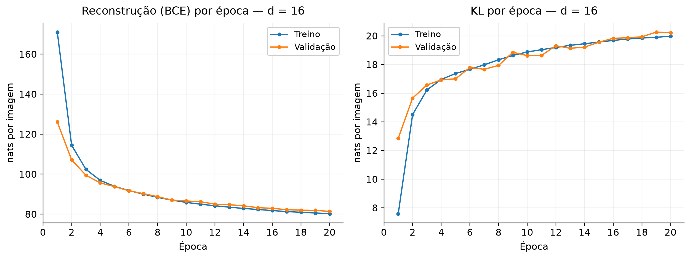
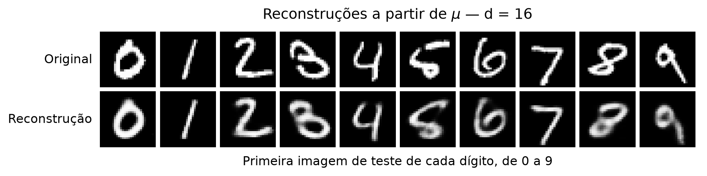
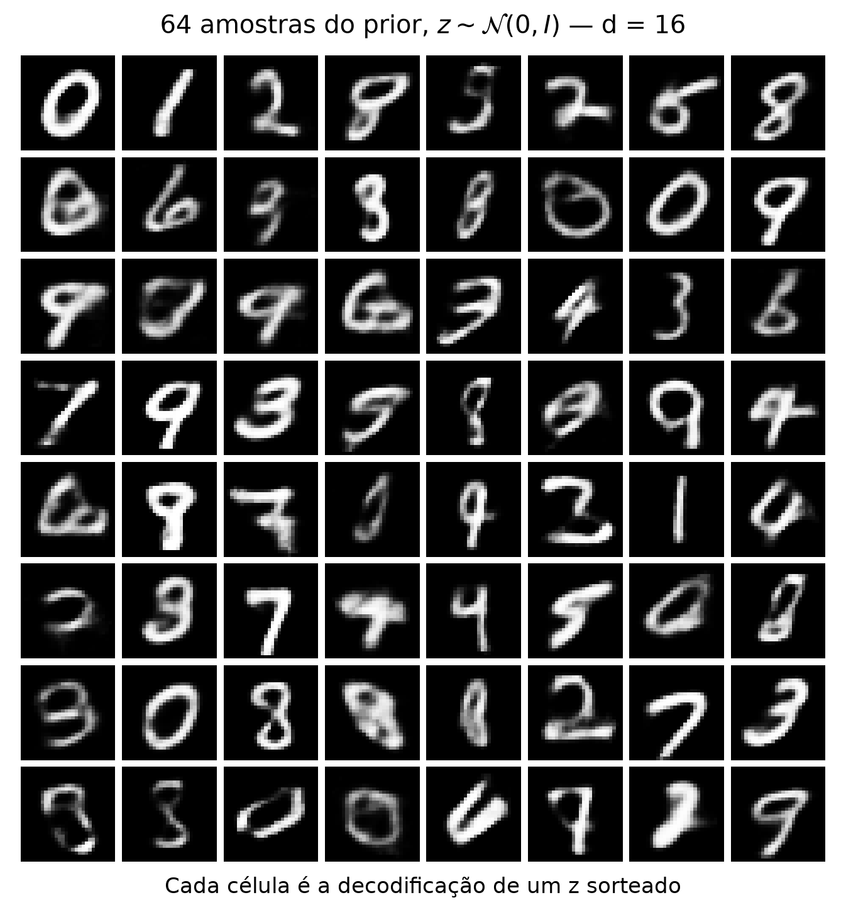
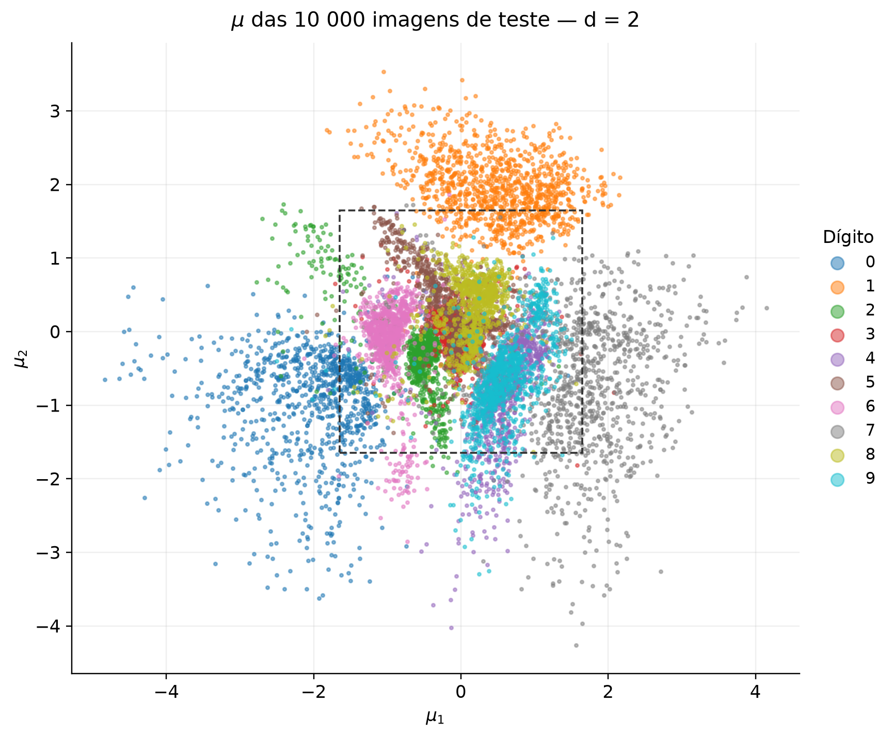
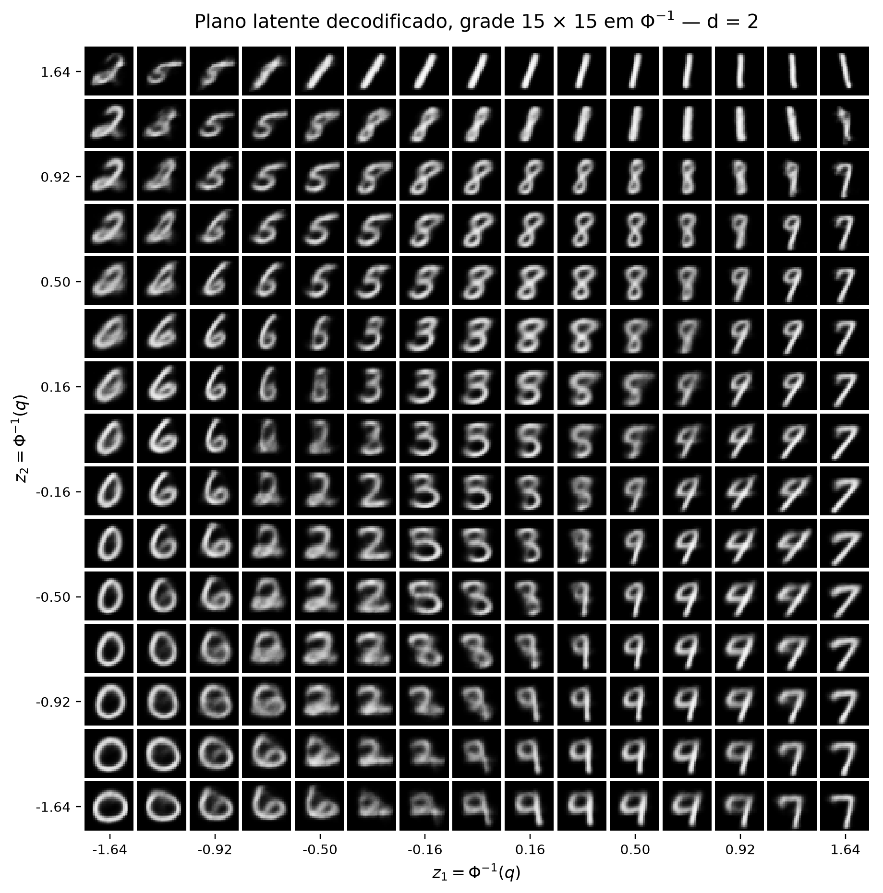
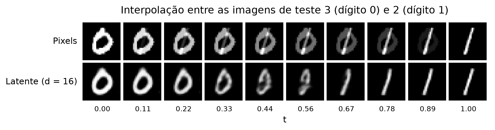

# 4. VAE

!!! abstract "Enunciado"

    [Exercises → VAE](https://insper.github.io/ann-dl/){:target='_blank'}

Nesta atividade, um autoencoder variacional (VAE) é treinado no MNIST. O Exercício 1 treina o modelo com um espaço latente de 16 dimensões e compara o que ele reconstrói com o que ele gera a partir do prior. O Exercício 2 reduz o espaço latente para 2 dimensões, para que ele possa ser desenhado, e compara interpolar no espaço de pixels com interpolar no espaço latente.

O modelo, a perda e o laço de treino estão em [`code/vae.py`](https://github.com/carolinaeskenazi/ann-dl/blob/main/docs/exercises/vae/code/vae.py) e são os mesmos nos dois exercícios; só a dimensão latente \(d\) muda. O arquivo [`code/data.py`](https://github.com/carolinaeskenazi/ann-dl/blob/main/docs/exercises/vae/code/data.py) carrega e divide o MNIST, e [`code/plots.py`](https://github.com/carolinaeskenazi/ann-dl/blob/main/docs/exercises/vae/code/plots.py) reúne os helpers das figuras. Cada modelo é construído logo depois de `torch.manual_seed(42)`, e a divisão treino/validação usa um gerador com semente 42.

Do PyTorch, foram usados apenas as camadas `nn.Linear`, as ativações, o Adam e o autograd. A reparametrização, os dois termos da perda e a amostragem foram escritos à mão, sem classe pronta de VAE e sem `kl_divergence`. Todas as perdas estão em **nats por imagem**: soma sobre os 784 pixels (ou sobre as \(d\) dimensões, no KL) e média sobre as imagens.

Além do `requirements.txt` do site, os scripts precisam de `torch`, `torchvision` e `scipy`, que já estão listados nele. O MNIST é baixado na primeira execução para `.cache/mnist`, pasta que fica fora do Git.

---

## Exercise 1 — A VAE on MNIST

O código deste exercício está em [`code/exercise1_mnist.py`](https://github.com/carolinaeskenazi/ann-dl/blob/main/docs/exercises/vae/code/exercise1_mnist.py). Ele treina o modelo com \(d = 16\), gera as Figuras 1, 2 e 3 e imprime os números citados abaixo. O modelo treinado fica salvo em `.cache/vae/vae_d16.pt`, porque o Exercício 2 o reaproveita. Para reproduzir, a partir da raiz do repositório (leva cerca de 6 minutos em CPU):

```bash
python docs/exercises/vae/code/exercise1_mnist.py
```

### A — Data

#### Abordagem

O MNIST vem do `torchvision`. Em vez de aplicar `ToTensor` imagem por imagem a cada época, as imagens são convertidas uma única vez: o tensor `uint8` de forma \((N, 28, 28)\) é dividido por 255, o que deixa os pixels em \([0, 1]\) (o mesmo resultado do `ToTensor`), e cada imagem é achatada em um vetor de 784.

As 60 000 imagens de treino oficiais são divididas com `random_split` e um `torch.Generator` com semente 42 em **50 000 de treino** e **10 000 de validação**. As 10 000 imagens de teste oficiais formam o conjunto de teste. O teste só é avaliado depois que o treino termina, para os números finais; durante o treino, só a validação é usada.

#### Código

??? example "Código — `data.py` — carregamento e divisão"

    ``` { .python .copy .select }
    --8<-- "docs/exercises/vae/code/data.py:data"
    ```

??? example "Código — `exercise1_mnist.py` — parâmetros e dados"

    ``` { .python .copy .select }
    --8<-- "docs/exercises/vae/code/exercise1_mnist.py:config"

    --8<-- "docs/exercises/vae/code/exercise1_mnist.py:data"
    ```

---

### B — Model and loss

#### Abordagem

**Arquitetura.** É a do enunciado:

| Parte              | Camadas                                                | Ativação                     |
| ------------------ | ------------------------------------------------------ | ---------------------------- |
| Encoder            | 784 → 512 → 256                                        | ReLU depois de cada camada   |
| Cabeças            | 256 → \(d\) para \(\mu\) e 256 → \(d\) para \(\log\sigma^2\) | nenhuma (lineares)     |
| Decoder            | \(d\) → 256 → 512 → 784                                | ReLU nas ocultas, sigmoide na saída |
| Dimensão latente   | \(d = 16\)                                             |                              |
| Parâmetros         | 1 079 600                                              |                              |

A cabeça da variância devolve \(\log\sigma^2\), e não \(\sigma\), porque assim ela pode assumir qualquer valor real e \(\sigma = \exp(\tfrac{1}{2}\log\sigma^2)\) é sempre positivo.

**Reparametrização.** O encoder define a posterior aproximada \(q(\mathbf{z}\mid\mathbf{x}) = \mathcal{N}(\boldsymbol{\mu}, \operatorname{diag}\boldsymbol{\sigma}^2)\). Sortear \(\mathbf{z}\) diretamente dela interromperia o gradiente, então o sorteio é feito em uma variável que não depende de nenhum parâmetro:

$$
\mathbf{z} = \boldsymbol{\mu} + \boldsymbol{\sigma}\odot\boldsymbol{\varepsilon},
\qquad \boldsymbol{\varepsilon}\sim\mathcal{N}(\mathbf{0}, I).
$$

Assim, \(\mathbf{z}\) é uma função determinística e diferenciável de \(\boldsymbol{\mu}\) e \(\log\boldsymbol{\sigma}^2\), e o gradiente da reconstrução chega ao encoder.

**Termo de reconstrução.** O decoder trata cada pixel como uma Bernoulli com probabilidade \(p_i = \sigma(l_i)\), em que \(l_i\) é o logit da última camada. O termo é a entropia cruzada binária somada sobre os 784 pixels:

$$
\mathcal{L}_\text{rec} = -\sum_{i=1}^{784}\Big[x_i\log p_i + (1-x_i)\log(1-p_i)\Big].
$$

No código, a última camada devolve o logit \(l_i\) e a sigmoide é aplicada à parte, em `decode()`. A BCE é calculada direto do logit: como \(\log\sigma(l) = -\operatorname{softplus}(-l)\) e \(\log(1-\sigma(l)) = -\operatorname{softplus}(l)\),

$$
-\big[x\log\sigma(l) + (1-x)\log(1-\sigma(l))\big]
= x\operatorname{softplus}(-l) + (1-x)\operatorname{softplus}(l)
= \operatorname{softplus}(l) - x\,l,
$$

usando \(\operatorname{softplus}(-l) = \operatorname{softplus}(l) - l\). É a mesma conta, mas sem calcular \(\log 0\) quando a sigmoide satura. Como conferência, o script compara a função escrita à mão com `F.binary_cross_entropy(..., reduction="sum")` nas 10 imagens da Figura 2: dá **958.4518** contra **958.4519**.

**Termo KL.** Entre duas gaussianas, o KL tem forma fechada. Para uma dimensão,

$$
\mathrm{KL}\big(\mathcal{N}(\mu, \sigma^2)\,\|\,\mathcal{N}(0, 1)\big)
= \frac{1}{2}\left(\sigma^2 + \mu^2 - 1 - \log\sigma^2\right),
$$

e, como a posterior e o prior são diagonais, o KL total é a soma sobre as \(d\) dimensões. Ele vale zero só quando \(\mu = 0\) e \(\sigma = 1\), ou seja, quando a posterior é igual ao prior.

**Perda.** Com \(\beta = 1\), a perda de um lote de \(B\) imagens é

$$
\mathcal{L} = \frac{1}{B}\sum_{n=1}^{B}\Big[\mathcal{L}_\text{rec}(\mathbf{x}_n) + \beta\,\mathrm{KL}_n\Big],
$$

que é o ELBO negativo médio por imagem. Os dois termos são somados (sobre pixels e sobre dimensões) e depois divididos por \(B\): o equivalente a `reduction="sum"` dividido pelo tamanho do lote. A `reduction="mean"` também dividiria a BCE por 784, e o KL passaria a pesar 784 vezes mais do que deveria em relação à reconstrução.

#### Código

??? example "Código — `vae.py` — modelo e reparametrização"

    ``` { .python .copy .select }
    --8<-- "docs/exercises/vae/code/vae.py:model"
    ```

??? example "Código — `vae.py` — BCE, KL e perda"

    ``` { .python .copy .select }
    --8<-- "docs/exercises/vae/code/vae.py:loss"
    ```

---

### C — Training

#### Abordagem

Adam com taxa de aprendizado \(10^{-3}\), lotes de 128 e 20 épocas. A cada época, o script guarda a média de reconstrução e de KL no treino e na validação.

* **Treino:** média dos lotes da época, ponderada pelo tamanho de cada lote (o último tem 80 imagens). O modelo muda ao longo da época, então esse número mistura o modelo do começo com o do fim.
* **Validação:** uma passada completa ao fim da época, com o modelo já atualizado.

Na avaliação, \(\mathbf{z}\) continua sendo sorteado, porque é o ELBO que se quer medir. O sorteio usa um gerador próprio com semente 0: assim a avaliação é reprodutível e não altera o gerador global que o treino usa. Antes da primeira época, o script também avalia a validação com o modelo não treinado ("época 0"), que é usada na análise do item E.

| Hiperparâmetro          | Valor                           |
| ----------------------- | ------------------------------- |
| Otimizador              | Adam, \(\text{lr} = 10^{-3}\)   |
| Tamanho do lote         | 128                             |
| Épocas                  | 20                              |
| \(\beta\)               | 1                               |

#### Código

??? example "Código — `vae.py` — parâmetros, avaliação e laço de treino"

    ``` { .python .copy .select }
    --8<-- "docs/exercises/vae/code/vae.py:config"

    --8<-- "docs/exercises/vae/code/vae.py:train"
    ```

??? example "Código — `exercise1_mnist.py` — treino, teste e Figura 1"

    ``` { .python .copy .select }
    --8<-- "docs/exercises/vae/code/exercise1_mnist.py:train"

    --8<-- "docs/exercises/vae/code/exercise1_mnist.py:fig1"
    ```

??? example "Código — `plots.py` — estilo e helpers de figura"

    ``` { .python .copy .select }
    --8<-- "docs/exercises/vae/code/plots.py:style"

    --8<-- "docs/exercises/vae/code/plots.py:helpers"
    ```

#### Resultados

Validação ao longo do treino (nats por imagem):

| Época | Reconstrução | KL        | Soma (ELBO negativo) |
| ----: | -----------: | --------: | -------------------: |
| 0     | 544.71       | 0.03      | 544.73               |
| 1     | 126.09       | **12.85** | 138.95               |
| 2     | 107.14       | 15.66     | 122.80               |
| 5     | 93.76        | 17.01     | 110.77               |
| 10    | 86.60        | 18.62     | 105.22               |
| 15    | 83.24        | 19.56     | 102.80               |
| 20    | 81.36        | **20.22** | 101.58               |

No conjunto de teste, avaliado uma única vez, com o modelo da época 20:

| Quantidade (teste)          | Valor (nats por imagem) |
| --------------------------- | ----------------------: |
| Reconstrução                | **80.65**               |
| KL                          | **20.23**               |
| **ELBO negativo** (soma)    | **100.88**              |

Os valores ficaram próximos dos de referência do enunciado (cerca de 81 e 20).

#### Figuras


/// caption
**Figura 1** — Os dois termos da perda por época, no treino (azul) e na validação (laranja). À esquerda, a reconstrução cai de 126.09 para 81.36 na validação. À direita, o KL sobe de 12.85 para 20.22. A soma dos dois (o ELBO negativo) cai de 138.95 para 101.58 (tabela acima). Na época 1, a curva de treino fica acima da de validação na reconstrução e abaixo no KL porque é a média de uma época em que o modelo saiu do zero; da época 4 em diante, as duas curvas praticamente coincidem.
///

---

### D — Reconstructions and samples

#### Abordagem

* **Figura 2:** a primeira imagem de teste de cada dígito, de 0 a 9 (índices 3, 2, 1, 18, 4, 8, 11, 0, 61 e 7), e a reconstrução de cada uma. A reconstrução decodifica \(\boldsymbol{\mu}\) diretamente, sem sortear \(\mathbf{z}\).
* **Figura 3:** 64 vetores \(\mathbf{z}\sim\mathcal{N}(\mathbf{0}, I)\), sorteados logo depois de `torch.manual_seed(0)` e decodificados em uma grade 8 × 8.

Nas duas figuras, o que aparece é a saída da sigmoide, isto é, a probabilidade de cada pixel estar aceso, e não uma amostra binária da Bernoulli.

#### Código

??? example "Código — `exercise1_mnist.py` — Figuras 2 e 3"

    ``` { .python .copy .select }
    --8<-- "docs/exercises/vae/code/exercise1_mnist.py:fig2"

    --8<-- "docs/exercises/vae/code/exercise1_mnist.py:fig3"
    ```

#### Figuras


/// caption
**Figura 2** — Linha de cima: a primeira imagem de teste de cada dígito. Linha de baixo: a reconstrução a partir de \(\boldsymbol{\mu}\). A forma e a inclinação são preservadas em todas, com traço mais borrado. O 3, que no original tem as pontas quase fechadas, é reconstruído parecido com um 8.
///


/// caption
**Figura 3** — 64 amostras do prior, decodificadas. Boa parte é um dígito legível (0, 1, 7, 9 e 3 bem formados), mas várias células são misturas sem um dígito claro, com traços fantasmas e borrados.
///

---

### E — Analysis

**1. Por que o KL sobe nas primeiras épocas enquanto a perda total cai?**

O KL mede quanta informação o código \(\mathbf{z}\) carrega sobre a imagem: ele só é zero quando \(q(\mathbf{z}\mid\mathbf{x})\) é igual ao prior para toda imagem, e nesse caso \(\mathbf{z}\) não diz nada sobre \(\mathbf{x}\). É o que acontece na inicialização. Na época 0, os pesos são pequenos, \(\boldsymbol{\mu}\approx\mathbf{0}\) e \(\log\boldsymbol{\sigma}^2\approx\mathbf{0}\), e o KL de validação é **0.03**. Em compensação, o decoder recebe um \(\mathbf{z}\) que não depende da imagem, e a reconstrução vale **544.71**.

Para reconstruir melhor, o encoder precisa colocar informação em \(\mathbf{z}\), afastando \(\boldsymbol{\mu}\) da origem e estreitando \(\boldsymbol{\sigma}\), e isso aumenta o KL. As duas coisas aparecem juntas, mas com tamanhos muito diferentes: da época 0 para a 1, a reconstrução cai **418.6** nats e o KL sobe **12.8**. Da época 1 para a 20, a reconstrução cai mais **44.7** e o KL sobe mais **7.4**. Enquanto cada nat a mais de informação em \(\mathbf{z}\) economizar mais de um nat de reconstrução, o otimizador continua pagando o KL, e a soma desce, de 544.73 para 101.58. A subida do KL vai ficando mais lenta (de 12.85 para 15.66 na época 2, mas só de 19.56 para 20.22 entre as épocas 15 e 20) porque o ganho de reconstrução por nat de informação diminui.

O modelo também mostra que só paga o KL onde ele compensa. Em **4 das 16 dimensões**, \(\boldsymbol{\mu}\) quase não varia entre as imagens de teste (desvio padrão de 0.03) e \(\sigma\) fica em 1.00: nessas dimensões a posterior é igual ao prior, o KL é zero e o decoder as ignora. Os 20 nats de KL estão nas outras 12.

**2. Por que a Figura 3 é pior do que a Figura 2?**

*Onde as amostras do prior caem no espaço latente.* O KL empurra cada posterior na direção de \(\mathcal{N}(\mathbf{0}, I)\), mas não a torna igual: nas dimensões ativas, \(\sigma\) fica entre 0.08 e 0.54, e cada imagem ocupa uma região estreita em torno do seu \(\boldsymbol{\mu}\). A união dessas regiões (a posterior agregada) não preenche o prior por igual: ela se concentra em agrupamentos, com buracos entre eles. O decoder só foi treinado com \(\mathbf{z}\) vindos dessas regiões. Um \(\mathbf{z}\) sorteado do prior não tem essa garantia. Para medir isso, o script compara a distância de cada ponto ao \(\boldsymbol{\mu}\) de treino mais próximo, nas 12 dimensões ativas: para imagens de validação, que o modelo nunca viu, a mediana é **1.19**; para amostras do prior, é **1.68**. E **48.4%** das amostras do prior ficam mais longe do que 95% das imagens de validação, quando o esperado, se elas caíssem onde caem as imagens reais, seria 5%. Quase metade das amostras da Figura 3 cai, portanto, em regiões onde o decoder quase não recebeu códigos de imagens reais, e nessas regiões ele devolve misturas. (As 4 dimensões não usadas ficam fora da conta: nelas o prior só acrescenta ruído, que o decoder ignora.)

*O que o decoder devolve para um \(\mathbf{z}\).* A saída do decoder não é uma imagem: é a probabilidade de cada pixel estar aceso, com os 784 pixels independentes dado \(\mathbf{z}\). Quando um \(\mathbf{z}\) é compatível com várias imagens (por exemplo, um 3 e um 8 parecidos), o que minimiza a BCE é a média delas, e a média de traços em posições diferentes é uma imagem borrada, com os dois traços em meio-tom. Os pixels não conseguem "combinar" entre si qual dos dois desenhos fazer, porque são independentes. Na Figura 2, o \(\boldsymbol{\mu}\) de uma imagem real cai em um ponto que identifica bem uma imagem, e a média fica nítida. Nas amostras do prior, que caem nas regiões ambíguas do item anterior, a média mistura dígitos diferentes, e é isso que aparece como os traços fantasmas da Figura 3.

**3. Por que decodificar \(\boldsymbol{\mu}\), e não um \(\mathbf{z}\) sorteado, na Figura 2?**

A Figura 2 deve mostrar o que o modelo guardou de cada imagem. \(\boldsymbol{\mu}\) é o centro e o ponto mais provável da posterior. Um \(\mathbf{z}\) sorteado somaria um ruído \(\boldsymbol{\sigma}\odot\boldsymbol{\varepsilon}\), que muda a cada sorteio e, nas dimensões em que \(\sigma\) é grande (até 0.54), pode levar o código para perto de outra imagem. A reconstrução passaria a misturar o que o encoder guardou com o acaso do sorteio, e a figura deixaria de ser reprodutível. Com \(\boldsymbol{\mu}\), a reconstrução é determinística: para a mesma imagem, sai sempre a mesma figura.

---

## Exercise 2 — A 2-D Latent Space

O código deste exercício está em [`code/exercise2_latent2d.py`](https://github.com/carolinaeskenazi/ann-dl/blob/main/docs/exercises/vae/code/exercise2_latent2d.py). Ele treina o modelo com \(d = 2\), reaproveita o modelo \(d = 16\) salvo pelo Exercício 1 (ou o treina, se o arquivo não existir), gera as Figuras 4, 5 e 6 e imprime os números citados abaixo. Para reproduzir:

```bash
python docs/exercises/vae/code/exercise2_latent2d.py
```

### A — 2-D model

#### Abordagem

É o mesmo código do Exercício 1, com a mesma semente, \(\beta = 1\), Adam com \(\text{lr} = 10^{-3}\), lotes de 128 e 20 épocas. A única mudança é `latent_dim=2`: as duas cabeças passam a ter 2 saídas e o decoder começa em 2 → 256.

#### Código

??? example "Código — `exercise2_latent2d.py` — parâmetros e treino"

    ``` { .python .copy .select }
    --8<-- "docs/exercises/vae/code/exercise2_latent2d.py:config"

    --8<-- "docs/exercises/vae/code/exercise2_latent2d.py:train"
    ```

??? example "Código — `vae.py` — salvar e reaproveitar o modelo"

    ``` { .python .copy .select }
    --8<-- "docs/exercises/vae/code/vae.py:checkpoint"
    ```

#### Resultados

No teste, em nats por imagem:

| Modelo      | Reconstrução | KL        | ELBO negativo |
| ----------- | -----------: | --------: | ------------: |
| \(d = 16\)  | 80.65        | 20.23     | 100.88        |
| \(d = 2\)   | **136.12**   | **6.45**  | **142.57**    |
| Diferença   | +55.47       | −13.78    | +41.69        |

Os valores de \(d = 2\) ficaram próximos dos de referência do enunciado (cerca de 135 e 7). Na validação, o KL de \(d = 2\) foi de 4.77 na época 1 para 6.45 na época 20.

Com 2 dimensões, o código carrega muito menos informação sobre a imagem (6.45 nats de KL, contra 20.23), e a reconstrução fica 55.47 nats pior. A economia de KL não compensa a perda de reconstrução, e o ELBO negativo piora em 41.69 nats.

---

### B — Encoded test set

#### Abordagem

As 10 000 imagens de teste passam pelo encoder do modelo \(d = 2\), e cada \(\boldsymbol{\mu}\) vira um ponto no plano, colorido pelo dígito. O quadrado tracejado marca a região coberta pela grade da Figura 5, de \(\Phi^{-1}(0.05)\) a \(\Phi^{-1}(0.95)\) nos dois eixos; **75.5%** dos pontos caem dentro dele, contra 81% (\(0.9^2\)) se os \(\boldsymbol{\mu}\) seguissem exatamente o prior. Os 24.5% que ficam fora são principalmente os 0, os 1 e os 7 mais extremos, nas pontas das suas nuvens; a Figura 5 não mostra essas variações, só a parte central do plano.

#### Código

??? example "Código — `exercise2_latent2d.py` — Figura 4"

    ``` { .python .copy .select }
    --8<-- "docs/exercises/vae/code/exercise2_latent2d.py:fig4"
    ```

#### Figuras


/// caption
**Figura 4** — \(\boldsymbol{\mu}\) das 10 000 imagens de teste no modelo \(d = 2\). O 0 (à esquerda), o 1 (em cima) e o 7 (à direita) formam grupos separados. O 4 e o 9 ocupam praticamente a mesma região, embaixo à direita do centro, e o 3, o 5 e o 8 se sobrepõem no centro. O quadrado tracejado é a área da grade da Figura 5.
///

---

### C — Decoded plane

#### Abordagem

A grade tem 15 × 15 pontos. Os 15 valores de cada eixo são \(z = \Phi^{-1}(q)\), com \(q\) igualmente espaçado em \([0.05, 0.95]\) e \(\Phi^{-1}\) dado por `scipy.stats.norm.ppf`, o que dá \(z\) de −1.645 a 1.645. Cada ponto \((z_1, z_2)\) é decodificado, com \(z_1\) crescendo da esquerda para a direita e \(z_2\) crescendo de baixo para cima, na mesma orientação da Figura 4.

**Por que esse espaçamento.** Como \(\Phi\) é a CDF do prior em cada eixo, valores de \(q\) igualmente espaçados dão vizinhos de \(z\) separados pela mesma massa de probabilidade (\(0.9/14\) por eixo), e, como as duas coordenadas do prior são independentes, cada célula da grade cobre a mesma massa do prior — as células ficam mais estreitas perto da origem, onde o prior é mais denso, e mais largas nas bordas.

#### Código

??? example "Código — `exercise2_latent2d.py` — Figura 5"

    ``` { .python .copy .select }
    --8<-- "docs/exercises/vae/code/exercise2_latent2d.py:fig5"
    ```

#### Figuras


/// caption
**Figura 5** — O plano latente decodificado em uma grade de \(\Phi^{-1}\). Os dígitos mudam de forma contínua entre células vizinhas: 0 à esquerda, 1 em cima, 7 à direita, 9 e 4 embaixo à direita, e 2, 3, 5, 6 e 8 no meio. Os 1 da primeira linha mudam só de inclinação.
///

---

### D — Interpolation

#### Abordagem

As imagens interpoladas são a de teste **3** (um 0) e a de teste **2** (um 1), escolhidas por terem formas bem diferentes: um anel e um traço. Com \(t\) em 10 valores igualmente espaçados de 0 a 1:

* **Linha de cima (pixels):** \((1-t)\,\mathbf{x}_a + t\,\mathbf{x}_b\), a média ponderada das duas imagens.
* **Linha de baixo (latente, modelo \(d = 16\)):** \(\boldsymbol{\mu}_a\) e \(\boldsymbol{\mu}_b\) vêm do encoder, e cada \((1-t)\,\boldsymbol{\mu}_a + t\,\boldsymbol{\mu}_b\) é decodificado.

#### Código

??? example "Código — `exercise2_latent2d.py` — Figura 6"

    ``` { .python .copy .select }
    --8<-- "docs/exercises/vae/code/exercise2_latent2d.py:fig6"
    ```

#### Figuras


/// caption
**Figura 6** — Interpolação entre a imagem de teste 3 (um 0) e a 2 (um 1). Em cima, no espaço de pixels: o anel vai se apagando enquanto o traço se acende, e as imagens do meio têm os dois desenhos sobrepostos. Embaixo, no espaço latente do modelo \(d = 16\): o 0 se estreita e se inclina até virar um 1, sempre com um único traço.
///

---

### E — Analysis

**1. Quais dígitos se sobrepõem na Figura 4, e como é essa transição na Figura 5?**

A maior sobreposição da Figura 4 é entre o **4 e o 9**: as duas nuvens ocupam a mesma faixa diagonal, embaixo à direita do centro, por volta de \(\mu \approx (0.5, -0.8)\). O segundo grupo é **3, 5 e 8**, no centro do plano. Para medir isso sem usar o teste, o script ajusta um k-NN (\(k = 15\)) nos \(\boldsymbol{\mu}\) de treino e o avalia nos \(\boldsymbol{\mu}\) de validação. A acurácia é de 78.15%, e os pares mais confundidos são:

| Par      | Erros na validação | Detalhe              |
| -------- | -----------------: | -------------------- |
| **4 ↔ 9** | **661**           | 4→9: 322 e 9→4: 339  |
| 3 ↔ 5    | 329                | 3→5: 120 e 5→3: 209  |
| 3 ↔ 8    | 226                | 3→8: 95 e 8→3: 131   |
| 5 ↔ 8    | 189                | 5→8: 81 e 8→5: 108   |

O par 4 ↔ 9 sozinho tem mais erros do que os dois seguintes somados.

Na Figura 5, a mesma transição está na parte de baixo à direita, entre \(z_1 \approx 0.5\) e \(1.2\) e \(z_2 \approx -0.2\) e \(-0.7\). As células de baixo dessa região são um 9 com o laço fechado; subindo e indo para a direita, o laço vai se abrindo no topo, e por volta de \(z_1 \approx 0.9\)–\(1.2\), \(z_2 \approx -0.2\)–\(-0.3\) aparecem 4 com o topo aberto e o traço da direita mais longo. As células do meio não são nem um nem outro: têm a haste vertical dos dois, e o topo é um laço só parcialmente fechado, mais borrado do que as células de um dígito só. No 4 e no 9 escritos à mão, a diferença é justamente se o topo fecha ou não, e o modelo coloca essa diferença em uma direção contínua do plano.

**2. O que um código de dois números obriga o modelo a descartar?**

Com \(d = 16\), o código guarda 20.23 nats sobre cada imagem; com \(d = 2\), só 6.45. Dois números precisam dizer, ao mesmo tempo, qual é o dígito e como ele foi escrito, e não há espaço para os dois. A Figura 5 mostra o que sobra: cada dígito ocupa uma região do plano, e, dentro dela, só uma ou duas variações de estilo. Os 1 da primeira linha só mudam de inclinação, os 0 do canto inferior esquerdo só mudam de largura e de inclinação, e todos os dígitos têm a mesma espessura de traço, uniforme e meio borrada. O que é próprio de cada imagem é descartado: a espessura do traço, os pequenos ganchos e pontas, a altura exata de cada laço, a posição dentro da imagem. O decoder devolve uma versão média do dígito daquela região. É isso que custa os 55.47 nats a mais de reconstrução, e é também o que faz dígitos diferentes ficarem lado a lado com transições contínuas: no plano, não há espaço para separar o 4 do 9 nem o 3 do 5 e do 8 com uma margem.

**3. Qual linha da Figura 6 passa por imagens com cara de dígito, e por que a outra não?**

A **linha latente** (de baixo). Ela passa por formas com um único traço: o 0 se estreita e se inclina (\(t\) até 0.33), passa por duas imagens de transição mais borradas (\(t = 0.44\) e \(0.56\)), que parecem um 0 ou um 9 estreito, e a partir de \(t = 0.67\) já é um 1 inclinado. As imagens do meio não são perfeitas, mas cada uma é um desenho só, com a espessura de um traço.

A **linha de pixels** não passa por nenhum dígito: todas as imagens intermediárias são o anel e o traço sobrepostos, um apagando e o outro acendendo. Isso acontece porque a média de duas imagens de dígitos não é a imagem de um dígito. As imagens de dígitos ocupam uma parte muito pequena do espaço de 784 pixels, e o segmento reto entre duas delas sai dessa parte. No espaço latente, o decoder transforma cada ponto em uma imagem parecida com as do treino, então andar em linha reta entre dois códigos vira, nos pixels, um caminho curvo que deforma um desenho no outro. Nas duas imagens do meio, o caminho passa entre as regiões dos dois dígitos, onde o decoder tem menos dados, e por isso elas são mais borradas (é o mesmo efeito do item 1E-2).

---

## Discussão

Os dois exercícios usam o mesmo modelo e mostram que o VAE equilibra dois termos. No Exercício 1, com \(d = 16\), a reconstrução chegou a 80.65 nats no teste e o KL a 20.23. O KL subiu durante todo o treino, de 0.03 para 20.22 na validação, porque o modelo passou a colocar mais informação em \(\mathbf{z}\) sempre que isso reduzia a reconstrução por mais do que custava. O modelo não usou 4 das 16 dimensões.

As reconstruções da Figura 2 são nítidas, e as amostras da Figura 3 são piores. As codificações das imagens reais ocupam só uma parte do prior, e o decoder devolve uma média de pixels, que vira borrão quando o código é ambíguo.

No Exercício 2, com \(d = 2\), o código caiu para 6.45 nats e a reconstrução piorou 55.47 nats. Em troca, o espaço latente pode ser desenhado: os dígitos formam regiões, com 4 ↔ 9 e 3 ↔ 5 ↔ 8 sobrepostos, e o plano decodificado passa de um dígito para outro de forma contínua. A interpolação mostrou a mesma ideia no modelo \(d = 16\): andar no espaço latente deforma um desenho no outro, enquanto andar no espaço de pixels só sobrepõe os dois.

---

## Conclusão

O ELBO tem dois termos que puxam em sentidos opostos, e as figuras desta atividade mostram as consequências de cada um. A reconstrução pede que \(\mathbf{z}\) guarde o máximo sobre a imagem. O KL cobra por essa informação e aproxima as posteriores do prior, mas não as torna iguais a ele; por isso amostrar do prior dá resultados piores do que reconstruir.

Reduzir \(d\) de 16 para 2 deixa o espaço latente visível, mas custa caro: o modelo passa a guardar só a identidade do dígito e uma ou duas variações de estilo.

---

## Results summary

|  # | Quantidade                                                   | Valor                                                                                   |
| -: | ------------------------------------------------------------ | --------------------------------------------------------------------------------------- |
|  1 | Ex. 1 — reconstrução, KL e ELBO negativo no teste (\(d = 16\)) | Reconstrução **80.65**, KL **20.23**, ELBO negativo **100.88** nats por imagem          |
|  2 | Ex. 1 — KL de validação na primeira e na última época        | Época 1: **12.85**; época 20: **20.22** nats por imagem                                 |
|  3 | Ex. 2 — reconstrução e KL no teste (\(d = 2\))               | Reconstrução **136.12**, KL **6.45** nats por imagem (ELBO negativo 142.57)             |
|  4 | Ex. 2 — índices de teste interpolados                        | **3** (dígito 0) e **2** (dígito 1)                                                     |

Todos os números são impressos pelos próprios scripts e reproduzem a partir da semente 42.
